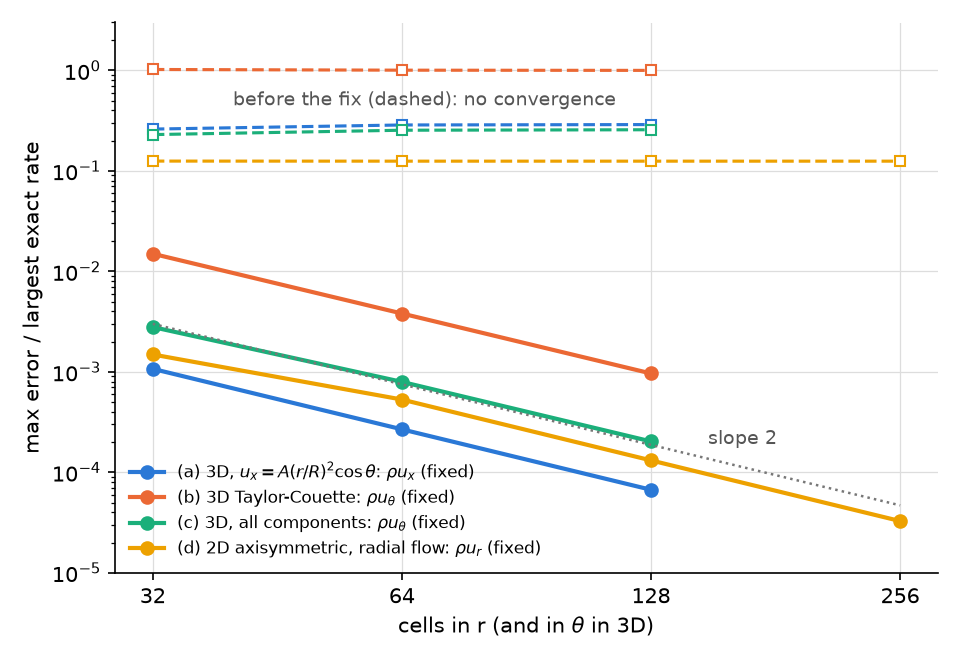

@page validation_coordinates Validation: Cylindrical Coordinates and Stretched Grids

# Coordinates and grids: axisymmetric focusing, the cylindrical viscous operator and a stretched 1D grid

**Status:** partially validated. The focal pressure of an axisymmetric transducer converges to the exact on-axis solution (−0.4 % at the finest grid) and arrives on time (shift 0.01 \f$\Delta t\f$), but 4 % of the waveform differs in its tails. On a stretched grid the 1D pulse is as accurate as on the uniform grid. **Code:** `master` at 3e4c53258 with the stage-time fix of [#2462](https://github.com/MFlowCode/MFC/issues/2462). The viscous operator in 3D cylindrical and 2D axisymmetric coordinates converges at second order to manufactured solutions ([#1910](https://github.com/MFlowCode/MFC/issues/1910)). **Examples:** `examples/2D_acoustic_support6_axisym`, `examples/3D_cyl_viscous_mms`, `examples/1D_acoustic_gauss_sigmatime`. See also @ref validation and @ref validation_acoustics.

## Axisymmetric focused transducer {#sec-validation-coordinates-focus}

| Item | Value |
| :--- | :--- |
| Medium | water, stiffened gas \f$\gamma\f$ = 4.4, \f$\pi_\infty\f$ = 5.57e8 Pa, 1100 kg/m³, 1e5 Pa; c = 1492.8 m/s |
| Geometry | `cyl_coord = T`, \f$x \in [0, 1]\f$ mm, \f$r \in [0, 0.5]\f$ mm, axis at r = 0 (`bc_y%%beg = -2`), non-reflecting elsewhere |
| Source | `support = 6`: spherical cap, radius of curvature F = 0.54 mm, aperture 2a = 0.8 mm (depth h = 0.177 mm), apex at x = 0.06 mm; Gaussian pulse \f$\sigma_t\f$ = 20 ns, delay 100 ns, `mag` = 1 Pa |
| Numerics | WENO5 with TENO, HLLC, SSP-RK3; 100 x 50 cells (the example) times k = 1, 2, 4, 8, \f$\Delta t\f$ = 2 ns / k |
| Reference | exact on-axis linear field of a cap with uniform normal velocity (O'Neil \cite ONeil1949): \f$p(z,t) = \frac{F}{F - z}[p_0(t - z/c) - p_0(t - R_e/c)]\f$, \f$R_e = \sqrt{a^2 + (z - h)^2}\f$, z from the apex; at the focus \f$(h/c)\,dp_0/dt\f$, peaks \f$\pm\,\mathrm{mag}\,h/(c\sigma_t\sqrt{e})\f$ = ±3.60 Pa |
| Measured | `check_focus.py`: pressure of a probe in the cell just past the focus, every step (`--probe`; row k is the state at k \f$\Delta t\f$); positive and negative peak values and times, relative L2 error of the signal, least-squares time shift and the L2 error left after it |

| k | cells per \f$c\sigma_t\f$ | positive peak [Pa] | error | negative peak [Pa] | error | shift [ns] | shift / \f$\Delta t\f$ | rel. L2 | rel. L2 after the shift |
| ---: | ---: | ---: | ---: | ---: | ---: | ---: | ---: | ---: | ---: |
| 1 | 3.0 | 2.949 | −17.4 % | −2.989 | −16.3 % | −0.27 | −0.14 | 0.176 | 0.174 |
| 2 | 6.0 | 3.426 | −4.5 % | −3.428 | −4.4 % | −0.06 | −0.06 | 0.059 | 0.059 |
| 4 | 11.9 | 3.554 | −1.1 % | −3.557 | −1.0 % | −0.020 | −0.04 | 0.041 | 0.041 |
| 8 | 23.9 | 3.584 | −0.37 % | −3.585 | −0.34 % | −0.003 | −0.01 | 0.039 | 0.039 |

The exact peak at the probe (0.62 to 5 µm past the focus) is 3.572 to 3.597 Pa; the errors are against that value.
k = 1, 2 and 4 were run on the CPU with NVHPC 25.11 (eight ranks) and k = 1, 2, 4 and 8 on an NVIDIA A100 (NVHPC 25.5, OpenACC, one GPU); where both ran, the peaks agree to three digits and the shifts and L2 errors to two.
The peak pressure converges at second order (4.5 %, 1.1 %, 0.37 %), so the axisymmetric source with its curvature correction, the geometric source terms and the axis reproduce the focal gain of the cap.
The focal signal arrives on time: the shift falls from −0.14 to −0.01 \f$\Delta t\f$ with the grid. Before the fix of [#2462](https://github.com/MFlowCode/MFC/issues/2462) it lagged by 1.5 \f$\Delta t\f$ at every resolution. \f$\Delta t/2\f$ of that was the step-start source time. The other \f$\Delta t\f$ was in `check_focus.py`, which placed probe row k at \f$(k+1)\Delta t\f$: the probe is written in the first stage of step k from the state at the start of the step, \f$k\Delta t\f$. One difference remains: a 4 % L2 difference stays as the grid is refined. It sits in the tails of the signal, and whether it comes from the free (unbaffled) edge of the MFC source against the baffled cap of the O'Neil solution was not separated.

Limits: one transducer geometry and one probe point on the axis; the off-axis field, the element arrays (`support = 9, 10`) and the 3D transducers are not compared.

## Cylindrical viscous operator {#sec-validation-coordinates-viscous}

| Item | Value |
| :--- | :--- |
| Equations | \f$\mathbf{f} = \nabla\cdot\boldsymbol{\tau}\f$ and \f$W = \nabla\cdot(\boldsymbol{\tau}\cdot\mathbf{u})\f$ with \f$\boldsymbol{\tau} = \mu(\nabla\mathbf{u} + \nabla\mathbf{u}^T) + (\mu_b - 2\mu/3)(\nabla\cdot\mathbf{u})\mathbf{I}\f$ in (x, r, \f$\theta\f$): \f$f_r\f$ carries \f$-\tau_{\theta\theta}/r\f$, \f$f_\theta\f$ carries \f$+\tau_{r\theta}/r\f$, every \f$\theta\f$ derivative carries \f$1/r\f$ |
| Geometry | r in [0, 2] with the axis (`bc_y%%beg = -14` in 3D, `-2` in 2D), \f$\theta\f$ periodic, x periodic with 26 cells; fields independent of x |
| Fields | (a) \f$u_x = A(r/R)^2\cos\theta\f$ (exact \f$f_x = 3\mu A\cos\theta/R^2\f$ at every r); (b) Taylor-Couette \f$u_\theta = A(r + 0.5/r)\f$ (exact \f$\mathbf{f} = 0\f$, rings with r \f$\ge\f$ 0.5); (c) \f$u_x = Ar^3\cos\theta\f$, \f$u_r = Ar^2\cos\theta\f$, \f$u_\theta = A(r^3 - r^2\sin\theta)\f$ with bulk viscosity; (d) 2D axisymmetric \f$u_x = A(r/R)^2\f$, \f$u_r = A(r/R)^3\f$ with bulk viscosity. \f$\mu\f$ = \f$\mu_b\f$ = 1, A = 0.1, \f$\rho\f$ = p = 1 |
| Measured | `run_mms.py`: one RK3 step, \f$\Delta t\f$ = 1e-8, rate = (q with viscosity - q without)/\f$\Delta t\f$ (the inviscid terms cancel) against the exact rates of `derive_rates.py` (sympy) at the cell centres; max norm over the rings away from the axis and the outer boundary, relative to the largest exact momentum rate (energy: the largest exact \f$W\f$; (b): the largest error before the fix) |



| Case, component | N = 32 | 64 | 128 | 256 | order | before the fix (N = 128) |
| :--- | ---: | ---: | ---: | ---: | ---: | ---: |
| (a) \f$\rho u_x\f$ | 1.07e-3 | 2.68e-4 | 6.70e-5 | | 2.0 | 0.289 |
| (a) \f$\rho E\f$ | 1.20e-3 | 2.95e-4 | 7.41e-5 | | 2.0 | 0.124 |
| (b) \f$\rho u_\theta\f$ | 1.50e-2 | 3.81e-3 | 9.63e-4 | | 2.0 | 1.00 |
| (c) \f$\rho u_x\f$ | 8.84e-4 | 3.27e-4 | 8.63e-5 | | 1.9 | 0.075 |
| (c) \f$\rho u_r\f$ | 1.32e-3 | 3.23e-4 | 8.05e-5 | | 2.0 | 0.107 |
| (c) \f$\rho u_\theta\f$ | 2.79e-3 | 7.94e-4 | 2.03e-4 | | 2.0 | 0.257 |
| (c) \f$\rho E\f$ | 1.24e-3 | 2.93e-4 | 7.30e-5 | | 2.0 | 0.078 |
| (d) \f$\rho u_r\f$ | 1.49e-3 | 5.30e-4 | 1.31e-4 | 3.27e-5 | 2.0 | 0.125 |
| (d) \f$\rho E\f$ | 8.19e-4 | 1.86e-4 | 4.60e-5 | 1.18e-5 | 2.0 | 0.038 |

GNU 13.3 on the CPU, one rank; order from the last two grids. On an NVIDIA Quadro RTX 6000 (NVHPC 25.11, OpenACC, N = 32 and 64) every entry reproduces the CPU error to three digits. Before the fix, 3D lacked the \f$1/r\f$ of the \f$\theta\f$ divergence and of both hoop terms, and 2D used the Cartesian (x, r) stress (no \f$u_r/r\f$ in \f$\nabla\cdot\mathbf{u}\f$, no \f$-\tau_{\theta\theta}/r\f$). The errors then stay O(1) and the measured rates match those of the defective operator (`MASTER` in `exact_rates.py`) to within the errors in the table: the issue's case gives \f$(4 - r)\,\mu A\cos\theta/R^2\f$ instead of \f$3\,\mu A\cos\theta/R^2\f$. Species diffusion uses the same metric (`--case S2`, `S3`). With \f$Y_{H_2} = Y_0 + 10^{-3}(r/R)^2\f$ (times \f$\cos\theta\f$ in 3D, N\f$_2\f$ compensating) at rest in h2o2 at uniform T and p with unity Lewis number, the exact rate of \f$\rho Y_{H_2}\f$ over \f$\epsilon/R^2\f$ is \f$4\rho D + 2r\,d(\rho D)/dr\f$ in 2D (\f$\rho D = k/c_p\f$ follows the local composition) and \f$3\rho D\f$ for the \f$\cos\theta\f$ coefficient in 3D, with \f$k/c_p\f$ from Cantera. The max-norm error relative to the exact mean is 6.7e-6, 1.7e-6, 5.4e-7 in 2D (N = 32, 64, 128) and 1.07e-3, 2.67e-4 in 3D (N = 32, 64), second order; these runs are GNU 12.3 on Phoenix. Before the fix the radial species diffusion was skipped with the axis boundary. Heat conduction in \f$\theta\f$ was already correct and is unchanged to round-off.

Limits: one step (the operator, not a time-accurate flow); smooth fields; the cells next to the axis and the outer boundary are excluded. Surface tension has no cylindrical metric terms in its gradients and is not covered; in 3D its theta divergence and the theta-face hoop terms (which share the momentum flux slots) now carry the \f$1/r\f$. With viscosity and species diffusion together, the axis cell's energy row misses the diffusive energy flux through its outer face ([#2513](https://github.com/MFlowCode/MFC/issues/2513)).

## Stretched grid {#sec-validation-coordinates-stretched}

The 1D Gaussian pulse of @ref validation_acoustics run on a stretched grid (`stretch_x`, `a_x` = 4, clustered on 0.3 to 0.6 mm, one loop): the same number of cells cover 0 to 1.68 mm with \f$\Delta x\f$ from 0.81 to 3.6 times the uniform spacing of 1 mm/N, and the largest change between neighbouring cells 0.8 %. The reference is the same linear solution, evaluated with the run's own cell widths, and \f$\Delta t\f$ is that of the uniform grid (c \f$\Delta t/\Delta x_\text{min}\f$ = 0.73).

| cells | \f$\Delta x\f$ range [µm] | A − 1 | \f$\tau/\Delta t\f$ | rel. L2 error | rel. L2 after the fit | uniform grid, same cells: A − 1 | uniform: rel. L2 after the fit |
| ---: | ---: | ---: | ---: | ---: | ---: | ---: | ---: |
| 200 | 4.07-17.9 | −1.51e-3 | +0.008 | 4.09e-3 | 3.8e-3 | −6.5e-4 | 2.2e-3 |
| 400 | 2.03-8.96 | −3.0e-4 | +0.008 | 6.58e-4 | 5.1e-4 | −1.2e-4 | 2.8e-4 |
| 800 | 1.02-4.49 | −1.6e-4 | +0.006 | 3.35e-4 | 2.7e-4 | −1.1e-4 | 2.3e-4 |

The stretched grid converges like the uniform one (the L2 error at order 2.6 from 200 to 400 cells), with errors about twice the uniform-grid values, with cells up to 3.6 times coarser than the uniform spacing. The pulse arrives on time (\f$\tau\f$ below 0.01 \f$\Delta t\f$; it lagged by \f$\Delta t/2\f$ before the fix of [#2462](https://github.com/MFlowCode/MFC/issues/2462)). At 800 cells both grids reach the round-off floor of the 1 Pa signal described on @ref validation_acoustics.

Limits: one stretching and one direction; a pulse that crosses the clustered region once; no shocks.

## Reproduce {#sec-validation-coordinates-run}

```
./mfc.sh run examples/2D_acoustic_support6_axisym/case.py -t pre_process simulation -n 1 -- --refine 4 --probe
python3 examples/2D_acoustic_support6_axisym/check_focus.py examples/2D_acoustic_support6_axisym --case-args "--refine 4 --probe"
./mfc.sh run examples/1D_acoustic_gauss_sigmatime/case.py -t pre_process simulation post_process -n 1 -- -N 400 --stretch 4
python3 examples/3D_cyl_viscous_mms/run_mms.py --case A3 -N 32 64 128   # also B3, C3, E2, and the species cases S2, S3
python3 examples/1D_acoustic_gauss_sigmatime/check_acoustic.py examples/1D_acoustic_gauss_sigmatime --case-args "-N 400 --stretch 4"
```
