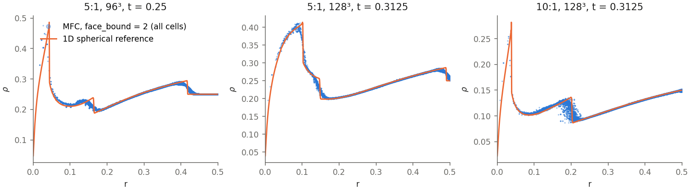
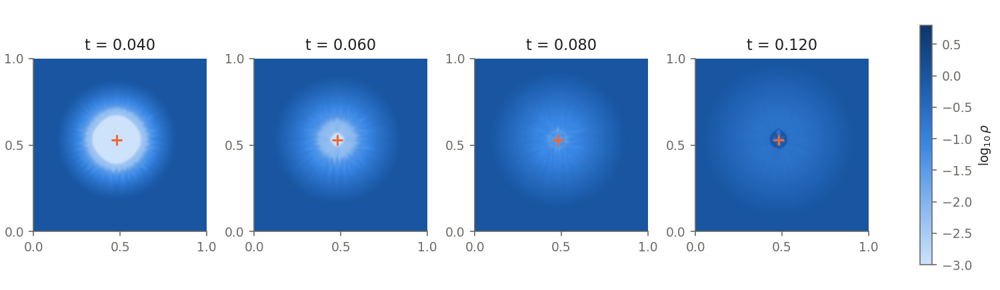

@page validation_positivity Validation: Positivity of Face States at a Near-Vacuum Collapse

# Positivity at a near-vacuum collapse: the Zhang-Shu face bound (`face_bound = 2`)

**Status:** validated (runs complete, density and pressure positive, agreement with a 1D spherical reference, order of accuracy
unchanged on smooth flow). **Code:** `master` at bb9cfe5e1 plus `face_bound = 2`. **Examples:** `examples/2D_vacuum_collapse`,
`examples/3D_amr_blast` (run without AMR). **Issues:** [#2469](https://github.com/MFlowCode/MFC/issues/2469),
[#2344](https://github.com/MFlowCode/MFC/issues/2344). **Last run:** 2026-11-26.

## Purpose

When a converging shock collapses onto a near-vacuum region, as at the centre of a spherical blast or in an implosion or a
cavitation collapse, unlimited WENO reconstruction can produce face states with negative pressure. The sound speed is then NaN and
the run stops. The cell averages are still positive at that point; only the reconstructed face states have left the admissible
set. `face_bound = 2` scales each cell's face states toward the cell state, by one factor per cell and direction and only as far
as the bounds require (\cite Zhang10). Where every bound already holds it changes nothing.

## Mechanism

A numpy replica of the scheme reproduces both issues step for step. It uses WENO5-JS (or mapped WENO5) on primitive variables,
HLLC with direct wave speeds, SSP-RK3 and \f$\Delta t = 0.1\,\Delta x\f$. It runs one octant with symmetry planes through the
blast centre.

| Case | Replica | MFC, `face_bound = 0` |
| :--- | :--- | :--- |
| 5:1 blast, 96³, WENO5 | negative face pressure at step 205 | NaN at step 206 (cell next to the centre) |
| 5:1 blast, 128³, WENO5 | negative face pressure at step 275 | NaN at step 276 (step 280 in #2469) |
| 10:1 blast, 64³, mapped WENO5 | negative face pressure at step 180 | NaN at step 181, cell (31, 31, 28) as in #2344 |
| 10:1 blast, 128³, WENO5 | negative face pressure at t = 0.284 | NaN by t = 0.31 (#2344) |
| centre \f$\rho\f$, \f$p\f$ at t = 0.1875 (5:1) | 0.0187, 0.0038 (96³) | 0.018, 0.0037 (128³, #2469) |

The 1D spherical reference below gives 0.0163 and 0.0031 at t = 0.1875: the run is accurate up to the collapse. In the replica
every cell average stays positive through every RK stage, and the failure is 3 to 6 face states next to the centre. Scaling
those face states toward their cell states takes all four cases through the collapse, with 6 to 30 cells limited in a whole run.

## The bounds

For each cell and direction, `face_bound = 2` finds the largest \f$\theta \in [0, 1]\f$ such that both face states
\f$\bar q + \theta(q_f - \bar q)\f$ (primitive variables) satisfy the following:

1. \f$\rho > 0\f$ and \f$p + p_\infty > 0\f$. These are linear in \f$\theta\f$, so \f$\theta\f$ has a closed form. \f$p_\infty\f$
   is that of the stiffest fluid, as in `face_bound = 1`, so liquid tension is not limited.
2. \f$(p + p_\infty)/\rho \le 1000 \max(\ldots)\f$ over the cell and its two neighbours along the direction. This is also linear
   in \f$\theta\f$. It bounds the face sound speed at about 32 times the largest nearby. Without it, a face whose density is
   scaled down to a tiny floor at finite pressure has an unbounded sound speed, and no fixed \f$\Delta t\f$ keeps the update
   positive (see the smooth test below).
3. The conservative interior point \f$\xi = (\bar U - w(U_L + U_R))/(1 - 2w)\f$ has positive density and
   \f$E - |m|^2/(2\rho) - \Pi_\infty - q_v + \Gamma p_\infty > 0\f$. Here \f$w\f$ is the Gauss-Lobatto end weight, 1/12 for
   WENO5 and 1/6 for WENO3, and \f$\theta\f$ is halved until \f$\xi\f$ is admissible. This is the Zhang-Shu condition: with it,
   the forward-Euler update of the cell average is a convex combination of positivity-preserving first-order updates. Cell
   averages then stay positive for \f$\Delta t \sum_d \max(|u_d| + c)/\Delta x_d \le w\f$.

Volume fractions get their own \f$\theta\f$, which keeps them in \f$[0, 1]\f$; in the 6-equation model the internal energies are
scaled with the rest of the state. The bound needs stiffened-gas fluids, so that \f$\Gamma\f$, \f$\Pi_\infty\f$ and \f$q_v\f$ are
linear in the volume fractions; `case_validator.py` rejects state-dependent equations of state, chemistry (use
`face_bound = 1`), bubbles, MHD, elasticity, relativity and IGR.

## Replica tests of the design (1D, 400 cells unless stated)

Same scheme, CFL on the cell states, \f$\theta\f$ as above (labelled "bound"). "Face only" is condition 1 alone, as
`face_bound = 1` does it. "Fails" means a negative face pressure or density.

| Problem | Unlimited | Face only | Bound |
| :--- | :--- | :--- | :--- |
| Leblanc shock tube, CFL 0.3 to 0.7 | fails at step 2 or 3 | completes | completes |
| Planar Sedov, ambient \f$p = 10^{-12}\f$, CFL 0.3 to 0.7 | fails at step 2 or 3 | completes | completes |
| 123 problem, \f$u = \pm 2\f$, CFL 0.7 | fails at step 4 | completes | completes |
| 123 problem, \f$u = \pm 3\f$, CFL 0.6 | fails at step 4 | completes | completes |
| 123 problem, \f$u = \pm 3\f$, CFL 0.7 | fails | negative cell average at step 4 | negative cell average at step 4 |
| \f$\rho = 1 + 0.99999 \sin 2\pi x\f$, \f$u = p = 1\f$, 20 cells | fails at step 1 | negative cell average at step 39 | completes |

The last row of the 123 problem is the CFL condition: past it no face bound can keep the cell average positive. On the smooth
near-vacuum sine, the bound is inactive at 80, 160 and 320 cells, and the L1 density errors after t = 0.5 are bit-identical to
the unlimited scheme: 6.98e-7, 2.18e-8 and 6.82e-10 (order 5.00, 5.00). A cap factor of 25 instead of 1000 acts at 40 to 160 cells and doubles the
error at 80, so 1000 is used. The interior-point condition (3) did not act in any of these tests; the face bounds were always
the binding ones.

## MFC: the blast and the 2D collapse

`face_bound = 2`, CPU: GNU 13.3 with OpenMPI 4.1.6 on 8 ranks. GPU: NVIDIA A100, NVHPC 25.11 OpenACC, on 1 rank.

| Case | `face_bound = 0` | `face_bound = 2` |
| :--- | :--- | :--- |
| 5:1 blast, 96³, 240 steps (t = 0.25) | NaN at step 206 | completes; A100 vs CPU 2.5e-13 |
| 5:1 blast, 128³, 400 steps (t = 0.3125) | NaN at step 276 | completes |
| 10:1 blast, 64³, mapped WENO5, 300 steps | NaN at step 181 | completes |
| 10:1 blast, 128³, 400 steps | NaN by t = 0.31 (#2344) | completes |
| `examples/3D_amr_blast`, 64³ base, one subcycled level, 200 steps | NaN at step 140 | completes |
| 2D collapse, 128², 1 fluid, 5-equation | NaN at step 271 | completes; A100 vs CPU 1.0e-12 |
| 2D collapse, 2 fluids, 5-equation | NaN at step 232 | completes; A100 vs CPU 1.9e-12 |
| 2D collapse, 2 fluids, 6-equation | NaN at step 246 | completes; A100 vs CPU 1.6e-12 |

GPU-CPU differences are the max-norm difference of the conservative state over its max-norm at the last save.

Density of every cell against radius, after the collapse, with `face_bound = 2`, against a 1D spherical solution of the same
scheme on 4000 cells (a finite-volume scheme in r with \f$r^2\f$ face areas, reflection at r = 0). The outgoing shock, the
contact and the reflected shock agree. The spread at a given r is the 3D grid's departure from spherical symmetry.

2D collapse, one fluid, 128², `face_bound = 2`: \f$\log_{10}\rho\f$ before, at and after the collapse onto the disc centre (+).
`check_collapse.py` passes for all three models. Minimum density and pressure stay positive at every save, and total mass and
energy are unchanged to 4e-13 until the outer rarefaction reaches the boundary.

## Order of accuracy

The advection convergence cases (`./mfc.sh test --only Convergence`) with `--face-bound 2`. Fitted order, and the L2 error on
the finest grid (Phoenix, GNU 12.3, double):

| Case | WENO5 | WENO5, `face_bound = 2` |
| :--- | :--- | :--- |
| 1D, N = 32, 64, 128 | 5.00, 3.298884e-11 | 5.00, 3.298884e-11 |
| 2D, N = 32, 64, 96 | 5.00, 3.714029e-10 | 5.00, 3.714029e-10 |
| 3D, N = 32, 64 | 5.00, 6.351377e-09 | 5.00, 6.351377e-09 |

The errors agree to all printed digits: on these smooth fields every bound already holds, so the limiter does not act.

## Limits

- The guarantee holds for \f$\Delta t \sum_d \max(|u_d| + c)/\Delta x_d \le w\f$ (1/12 for WENO5). The runs above use larger
  steps and stay positive, but a strong enough expansion at a large CFL, such as the 123 problem with \f$u = \pm 3\f$ at
  CFL 0.7, still produces a negative cell average.
- Of the densities, only the mixture density is bounded. Each partial density is scaled by the shared theta without a floor of
  its own, so the face partial density of a trace fluid can still be slightly negative where the sum is positive. The
  partial-density equations are conservative, so their cell averages follow the faces.
- Volume fractions get their own theta into [0, 1] at the faces, but their cell averages also depend on the non-conservative
  \f$\alpha\,\nabla\cdot u\f$ term, which the bound does not control.
- Values from `face_bound = 1` and `face_bound = 2` differ only where the extra bounds act. In the 1-fluid 2D collapse they gave
  the same minima to four digits.
