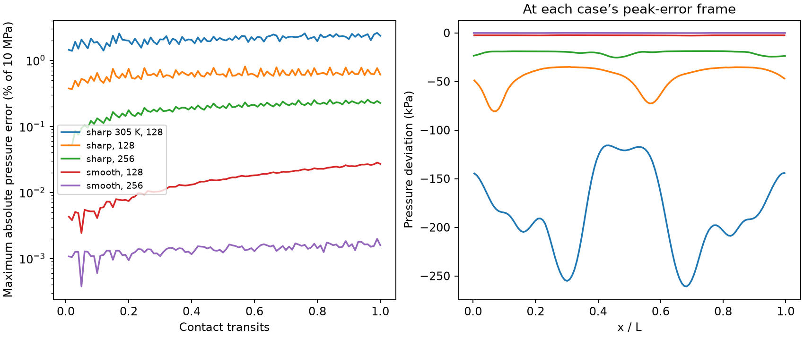

# Pressure equilibrium in advected xenon contacts

One-dimensional inviscid, periodic xenon at 10 MPa, velocity 20 m/s, density ratio 2. The exact profile translates 1 cm in 0.5 ms. Both pressure and velocity remain spatially uniform in the exact solution. Each row covers 101 frames over one transit. The maximum and RMS columns are independent maxima over the saved times, relative to 10 MPa.

| Case | Cells | Width/L | Dense T (K) | Peak maximum (%) | Peak RMS (%) | Maximum velocity error (m/s) |
|---|---:|---:|---:|---:|---:|---:|
| Smooth | 128 | .025 | 330 | .02836 | .02538 | .00557 |
| Smooth refined | 256 | .025 | 330 | .001991 | .001025 | .00164 |
| Sharp | 128 | .005 | 330 | .80725 | .53162 | .32655 |
| Sharp refined | 256 | .005 | 330 | .25374 | .20690 | .05108 |
| Pseudocritical | 128 | .005 | 305 | 2.60776 | 1.89395 | .80183 |

All five serial CPU runs finished. Each verifier accepted its initial density, velocity and pressure, then returned a failure at the specified relative equilibrium tolerance of 1e-8. Re-evaluation of pressure from saved conservative fields agreed with the solver pressure within 9e-15 relative to the base pressure. Across all frames, periodic mass, momentum and energy drift stayed below 1.5e-15 on characteristic scales (energy scale is the larger of initial absolute mean energy density and base pressure). The minimum saved temperature and pressure across all cases were 303.99 K and 9.7392 MPa. Each case directory contains its pressure_history.csv and rerun instructions.

## Why the pressure changes

At common velocity, a conservative update mixes density and internal energy per volume across an underresolved advecting interface. For PR xenon the constant-pressure curve in those two variables is curved. A mixture of conserved states can sit off that curve, so EOS recovery gives a pressure perturbation. Its gradient then accelerates the fluid. For example, an equal-volume conservative average of the two 330 K-case plateau states gives 9.0666 MPa. For the 305 K case it gives 6.4426 MPa. These are illustrative mixed states, distinct from the measured pressures of actual cells. Steeper gradients amplify the observed error, while grid refinement reduces it at either width.

Two auxiliary runs used the same 128-cell sharp initial density, grid, timestep, RK3, WENO5 and HLLC. Starting from the PR restart, the stationary control set momentum to zero and subtracted kinetic energy. The moving ideal-gas control kept momentum and initialized total energy to 1.5 times the base pressure plus kinetic energy. Both completed one original transit time. Their peak relative pressure errors were 2.9e-15 and 1.1e-14 respectively. This isolates the combination of interface advection and nonlinear thermodynamics. The experiment does not partition the error between spatial reconstruction, flux and time integration.

## Comparison with the earlier cases

The supercritical nitrogen flat plate had a 300 K freestream and a 270 K wall at 7.5 MPa. Its freestream compressibility factor was about 0.986. The wall produces viscous and thermal gradients, and the comparison measured velocity and temperature profiles and wall transfer. The saved final pressure range was 7.4972–7.6119 MPa on the 249 × 169 grid.

The supercritical xenon KH case uses the same 330 K dense-stream state and 10 MPa base as the smooth contact. Its imposed shear and transverse perturbation generate physical pressure gradients during vortex roll-up. The final 128 × 128 saved pressure range was 7.5299–10.9167 MPa. Pressure variation there combines flow physics and numerical effects. The earlier 64 × 64 KH comparison quantified differences between EOS solutions. Only the translating-contact experiment provides an exact constant-pressure reference throughout the run.

## Reproduction notes

The examples use runtime patch parameters for the analytic density profile so MFC can reuse one compiled expression across all five configurations. On this Mac the validation used the newly built serial contact preprocessor and the installed generic serial PR simulation executable. The contact-specific simulation include differs only in its initialization macro, which is expanded in the preprocessor. Each standalone case README gives the ordinary mfc.sh command. The corrected verifier accounts for the right-face coordinates that MFC writes next to cell-centered fields in the serial D files.
