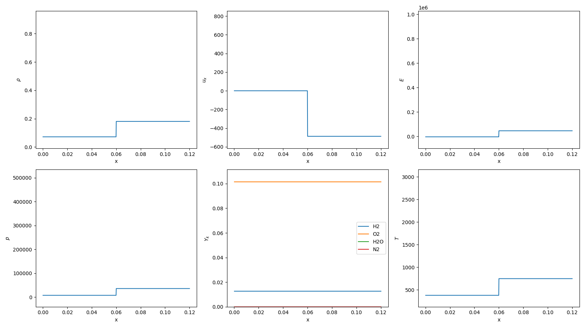
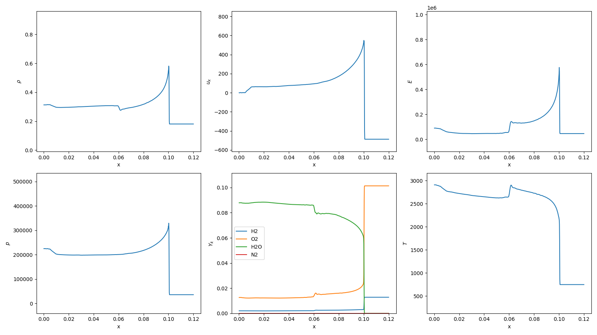

# 1D Multi-Component Reactive Shock Tube

References:
> P. J. Martínez Ferrer, R. Buttay, G. Lehnasch, and A. Mura, “A detailed verification procedure for compressible reactive multicomponent Navier–Stokes solvers”, Computers & Fluids, vol. 89, pp. 88–110, Jan. 2014. Accessed: Oct. 13, 2024. [Online]. Available: https://doi.org/10.1016/j.compfluid.2013.10.014

> H. Chen, C. Si, Y. Wu, H. Hu, and Y. Zhu, “Numerical investigation of the effect of equivalence ratio on the propagation characteristics and performance of rotating detonation engine”, Int. J. Hydrogen Energy, Mar. 2023. Accessed: Oct. 13, 2024. [Online]. Available: https://doi.org/10.1016/j.ijhydene.2023.03.190

## Initial Condition

## Results

## Comparison with the reference

`compare_reference.py` compares the temperature at 170, 190 and 230 us with the curves of Fig. 4.9 of the thesis of Martinez Ferrer (2013), which treats this case (`ref_T.txt`: read from the vector figure; the thesis uses the Kee et al. (1993) mechanism, not `h2o2.yaml`). Save every 5 us:

    ./mfc.sh run examples/1D_reactive_shocktube/case.py -t pre_process simulation post_process -n 1 -- --t_save_us 5
    python3 examples/1D_reactive_shocktube/compare_reference.py examples/1D_reactive_shocktube

`case.py` also takes `--substeps` (`chem_params%reaction_substeps`, default 4) and `--scale`. At 401 cells the leading shock is at 43.16, 58.76 and 100.62 mm (reference 43.25, 59.81, 99.89), and the burnt gas is about 100 K hotter than the reference. See @ref validation_gas_chemistry.
