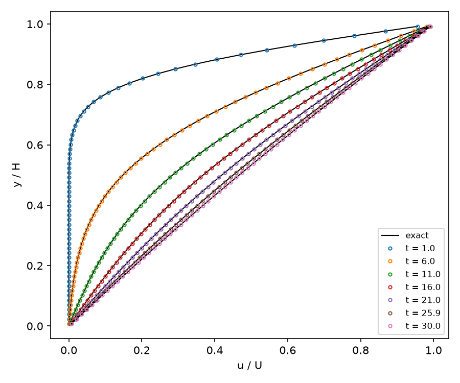

# Plane Couette Flow Startup (2D, all-Mach pressure projection)

Fluid at rest between a fixed lower wall and an upper wall that starts moving at U, periodic along the gap. The fluid is a
stiffened gas at Mach 0.01. `result.png` shows the validation result: the velocity profile across the gap at several times (symbols)
against the exact transient (lines),

