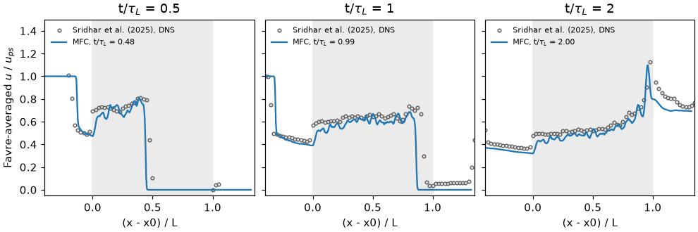

# Shock Through a Fixed Curtain of Particles (2D cylinders, 3D spheres, single sphere)

A planar Mach 1.66 shock in air (p1 = 82.7 kPa, T1 = 291.9 K) enters a random curtain of fixed no-slip bodies of diameter
115 um at a solid fraction of 0.2, periodic across the flow, with the post-shock state held at the inflow face. The quantity checked
is the Favre-averaged gas velocity through the curtain, against the particle-resolved DNS of Sridhar, Fox and Capecelatro (2025,
Case 5), whose profiles ship as `sridhar2025_ms166_phi02.txt` (values read from the published figure, binned medians). `--single`
puts one body at the shock's arrival point instead (unsteady drag against Mehta et al. 2016); `--moving` frees the bodies;
`--slip` and `--re_ps` select the wall model. The full results are on the @ref validation_shock_curtain page.

## Run

    ./mfc.sh run examples/2D_ibm_shock_curtain/case.py -n 1 --gpu

Without arguments this is the CI-sized run: 12 cylinders in a curtain 6 D thick and 8 D wide, 12 cells per diameter
(240 x 96 cells), 300 fixed steps with the shock inside the curtain (`2D -> IBM -> Shock Curtain`; the golden holds the conserved fields
and the force history). The comparison with the DNS is 3D and runs separately:

    ./mfc.sh run examples/2D_ibm_shock_curtain/case.py -t pre_process simulation post_process -n 1 --gpu -- \
        --dim 3 --h 17.4 --width 6 --xu 7 --xd 23 --cells_per_D 10 --steps 0 --tau 2 --frames 20 --silo
    python3 examples/2D_ibm_shock_curtain/check_curtain.py examples/2D_ibm_shock_curtain --png curtain_profiles.png

Single-sphere drag (Ms 1.22, inviscid slip wall, 12 cells per diameter, 0.62 M cells):

    ./mfc.sh run examples/2D_ibm_shock_curtain/case.py -n 1 --gpu -- --dim 3 --single --slip --mach 1.22 \
        --xu 3 --xd 7 --width 6 --cells_per_D 12 --steps 0 --tau 8 --stride 2
    python3 examples/2D_ibm_shock_curtain/check_curtain.py examples/2D_ibm_shock_curtain --drag --mach 1.22

## Results

NVIDIA A100 80GB, NVHPC 25.11, `master` at 0cdfdf02a, double precision, inviscid no-slip spheres, 239 of them in a 17.4 D curtain across a 6 D x 6 D periodic cross-section at 10 cells per diameter (1.08 M cells), `ib_ip_interp = 1`.

Mean absolute difference from the DNS profile in units of the post-shock velocity at the saves nearest the three panels
(t/tau_L = 0.5, 1, 2): 0.047, 0.050, 0.047 (seed 1) and 0.038, 0.050, 0.052 (seed 2). A single sphere at Ms 1.22 (inviscid slip
wall) gives a peak drag coefficient of 7.64 at 12 and 7.72 at 14 cells per diameter against 7.49 (Mehta et al. 2016), +1.9 % and +3.1 %;
with the no-slip ghost velocity and inviscid fluxes the peak is 8.9 (+19 %).
