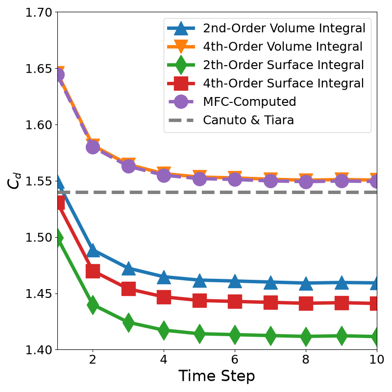

# 2D Viscous Drag Coefficient Convergence Test

## Case Set Up

This case file is an example of the convergence of the viscous drag over the surface of a 2D cylinder. We directly compare this result with the results of Canuto and Taira [1] which are the drag coefficient around a 2D cylinder in low-mach viscous flows for varying Mach and Reynolds numbers. The case set up is the exact parameters used by Taira and Colonius [2] with the additional determination of the freestream pressure from the freestream Mach number. A full list of coefficient and flow parameters can be determined in Table 4 of [1]. This case matches their setup for `Re = 40` and `Ma = 0.1`.

## Numerics

Of particular note in getting the numerics of this case to match closely to those of Canuto and Taira, we used two techniques:

1. `"low_mach": 2` enables an improved WENO reconstruction scheme which reduces low-mach disipation from Thornbet et al. [3]

2. `"mp_weno": "F"` disables MPWENO from Dinshaw, Balsara, and Shu [4] which clamps the WENO flux terms in an attempt to correct in the case of sharp discontinuities. However, these low-Mach low-Renolds cases are very smooth. So the clipping is not needed, but any triggerings could reduce our numeric accuracy. This proved to be a significant improvement.

## Result

To test the required convergence, comparisons to 4 different pressure and viscous drag force integration methods was made: surface integration and volume integration both computed at 2nd and 4th order. These values were compared in a post-processing step. The plot below demonstrates that the MFC calculation matched the post-processing implementation of 4th-order, and that this technique gives the appropriate convergence.

The plot above and the value below are historical. They come from MFC's earlier IB force, a volume integral of the pressure gradient and viscous-stress divergence over the body's cells, whose order `fd_order: 4` set. That estimator missed part of the friction drag (#2013) and has been removed: MFC now takes the IB force from the momentum fluxes the solver applies across the faces between body and fluid cells. `fd_order` therefore no longer affects the reported IB drag, and this case has not been re-run since the change.

Under the old estimator the final MFC-obtained drag coefficient was $C_{d}^{MFC} = 1.549$, against $C_{d}^{Canuto} = 1.540$ from Canuto and Taira.

For the face-flux force the nearest check is the `Re = 40` convergence study in #2017, run in a different configuration (`Ma = 0.2`, inert moist air with mixture-averaged transport): there the IB force gives $C_d = 1.505$, $1.512$ and $1.522$ at 20, 40 and 80 cells per diameter. Those agree to 0.1% with a control-volume momentum balance taken over the same runs, independent of the IB force, and converge with resolution; the volume integral converged at order $\approx 0.5$ from 13% below. Re-running this case to quote a new $C_{d}^{MFC}$ at its own `Ma = 0.1` setup remains to be done.

### References

[1] Canuto D, Taira K. Two-dimensional compressible viscous flow around a circular cylinder. Journal of Fluid Mechanics. 2015;785:349-371. doi:10.1017/jfm.2015.635

[2] Taira K, Colonius T. The immersed boundary method: A projection approach. Journal of Computational Physics. August 2007. doi:10.1016/j.jcp.2007.03.005

[3] B. Thornber, A. Mosedale, D. Drikakis, D. Youngs, R.J.R. Williams, An improved reconstruction method for compressible flows with low Mach number features. Journal of Computational Physics. Volume 227, Issue 10,2008, Pages 4873-4894. doi:10.1016/j.jcp.2008.01.036.

[4] Dinshaw S. Balsara, Chi-Wang Shu, Monotonicity Preserving Weighted Essentially Non-oscillatory Schemes with Increasingly High Order of Accuracy. Journal of Computational Physics. olume 160, Issue 2, 2000, Pages 405-452, doi:10.1006/jcph.2000.6443.