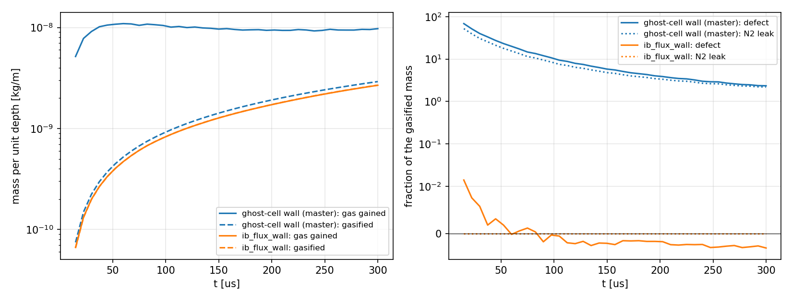

# 2D Gas-Mass Budget of a Reacting Immersed Boundary

A hot carbon cylinder (`surface_reaction = 1`, the surface solve of `2D_ibm_reacting_surface`) sits in quiescent air in a
fully periodic box of side 6 D. No gas can enter or leave, so the box gains mass only through the cylinder's surface, and the
mass it gains must equal the mass the surface gasifies. The inert species (N2) must not change at all.

`mass_budget.py` closes that budget from the run's output:

    gain   = M(t) - M(t_1)       gas mass in the fluid cells
    gasif  = integral of sum(area * mdot) over the body's surface records (ib_surface_wrt), trapezoid rule
    defect = (gain - gasif) / gasif
    leak   = (M_N2(t) - M_N2(t_1)) / gasif

## What it shows

Left: the gas mass gained (solid) and the mass gasified (dashed), for the default ghost-cell wall (blue) and with
`ib_flux_wall = T` (orange). Right: the defect and the N2 leak as fractions of the gasified mass (the axis is linear below
1e-2 and logarithmic above).

With the default wall, the faces between the fluid and the body carry the Riemann and diffusion fluxes of the ghost state,
which the ghost fill does not tie to the surface balance. The gas gains 3 to 69 times the mass the surface gasifies, and N2,
which no surface reaction touches, changes by multiples of it. With `ib_flux_wall = T` those faces carry the surface solve's
own rates: the defect is 1.4e-2 at the first save, below 1% afterwards and about 0.3% or less after 60 us, and the N2 leak stays at 1e-10 of the gasified mass.

| t [us] | gained, default [kg/m] | gasified, default [kg/m] | defect, default | N2 leak, default | defect, flux wall | N2 leak, flux wall |
|---:|---:|---:|---:|---:|---:|---:|
| 15 | 5.2e-9 | 7.4e-11 | 68 | 52 | 1.4e-2 | 4e-10 |
| 30 | 9.1e-9 | 2.2e-10 | 40 | 31 | 5.8e-3 | 0 |
| 60 | 1.09e-8 | 5.2e-10 | 20 | 15 | -1.8e-4 | 6e-11 |
| 105 | 1.01e-8 | 9.7e-10 | 9.4 | 7.5 | -5.4e-4 | 3e-11 |
| 300 | 9.7e-9 | 2.9e-9 | 2.3 | 2.2 | -3.1e-3 | -1e-11 |

The default-wall column is the behavior of the solver without the option, which was also run on an unmodified build of
master and gives the same table to all printed digits. Run on an AMD MI250X; an NVIDIA A100 gives the same table to the digits
shown, and 1 and 2 ranks (the rank seam through the cylinder) agree too.

## Run

Each run writes into the example directory, so save the table after each one:

    ./mfc.sh run examples/2D_ibm_wall_mass_budget/case.py -t pre_process simulation -n 1 --gpu mp
    python3 examples/2D_ibm_wall_mass_budget/mass_budget.py examples/2D_ibm_wall_mass_budget --csv off.csv

    ./mfc.sh run examples/2D_ibm_wall_mass_budget/case.py -t pre_process simulation -n 1 --gpu mp -- --flux_wall
    python3 examples/2D_ibm_wall_mass_budget/mass_budget.py examples/2D_ibm_wall_mass_budget --csv on.csv

    python3 examples/2D_ibm_wall_mass_budget/plot_budget.py ghost_cell=off.csv flux_wall=on.csv -o mass_budget.png

Use `--gpu acc` for an OpenACC build, or drop the GPU flags on a CPU build. `case.py` takes `--cells_per_D` (default 16),
`--t_end` (3e-4 s) and `--n_save` (40). `mass_budget.py --tol X` exits with an error if the final defect exceeds X, which makes
it usable as a check.

## Limits

The cylinder is fixed and the box is closed and quiescent: this is a conservation check on one geometry, not a validation of
the burn rate against measurements. The momentum treatment of a wall in tangential flow is not exercised here (the gas is
nearly at rest). The example is skipped in the test suite; the suite's `Flux Wall` test runs the option on the
`2D_ibm_reacting_surface` example.
