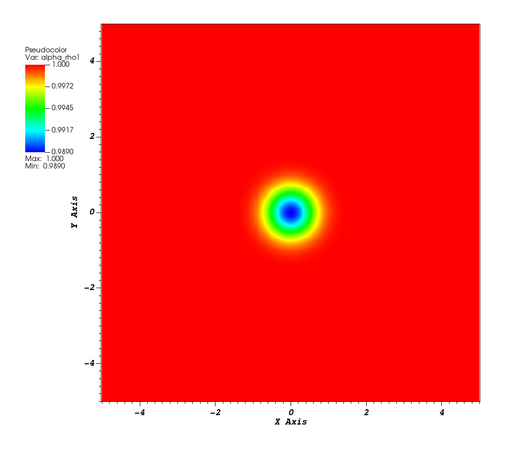
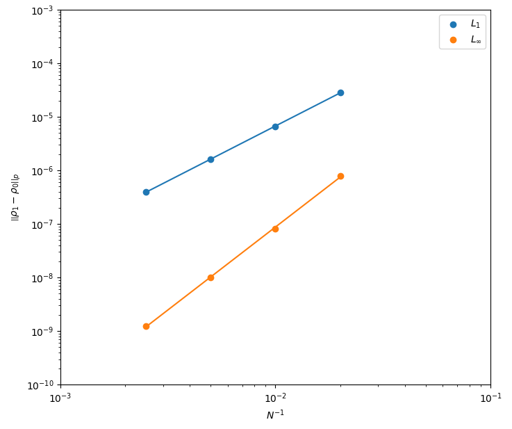

# Isentropic vortex problem (2D)

Reference: 
> Coralic, V., & Colonius, T. (2014). Finite-volume Weno scheme for viscous compressible multicomponent flows. Journal of Computational Physics, 274, 95–121. https://doi.org/10.1016/j.jcp.2014.06.003

## Density

## Density Norms

## Order of accuracy (`--convect`)

`case.py --convect` translates the vortex at (1, 0.5) through a periodic box $[-5, 5]^2$ on a uniform $N \times N$ grid, started from
exact conservative cell averages (`hcid = 283`); it takes `-N`, `--order`, `--scheme wenojs|wenom|wenoz|teno`, `--cfl`, `--t-end`
and `--time-stepper`. `check_vortex.py` prints the density error against the exact translated vortex and the observed order:

    ./mfc.sh run examples/2D_isentropicvortex/case.py -t pre_process simulation -n 1 -- --convect -N 128 --order 5
    python3 examples/2D_isentropicvortex/check_vortex.py <run N=64> <run N=128> <run N=256>

Every WENO and TENO order converges at second order on this flow (L1 1.37e-5 at N = 256 for WENO5 and WENO7 alike, #2464).
Results and limits: @ref validation_vortex_order.
