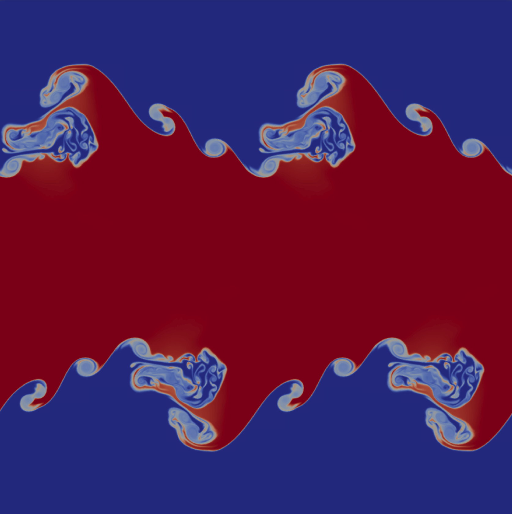

# Kelvin-Helmholtz Instability (2D)

Reference: See Example 4.8.
> A.S. Chamarthi, S.H. Frankel, A. Chintagunta, Implicit gradients based novel finite volume scheme for compressible single and multi-component flows, arXiv preprint arXiv:2106.01738 (2021).

### Initial State 

### Evolved State  

`mpp_lim` is off: this case runs without it, and it breaks pressure equilibrium at material interfaces (see `mpp_lim` in @ref case).
