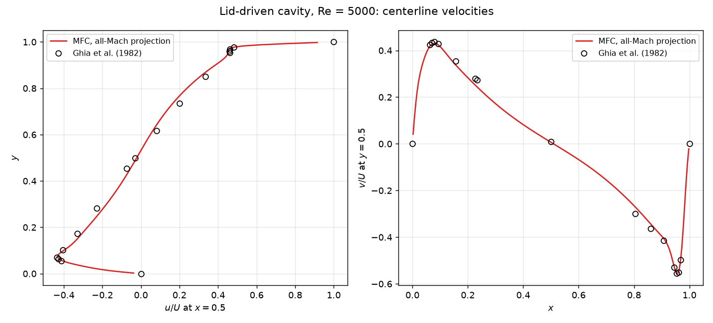

# Lid-Driven Cavity (2D, all-Mach pressure projection)

A unit square of a single ideal gas with no-slip walls; the top wall moves at 0.5. With ρ = 1 and μ = 1e-4 the Reynolds number is
5000, and the lid's Mach number, against the gas's sound speed of 2.6, is about 0.2. The case runs to t = 200 on 200 × 200 cells;
`--explicit` runs the HLLC solver (`low_Mach = 2`) instead.

```shell
./mfc.sh run examples/2D_lid_driven_cavity_projection/case.py --case-optimization
```

`result.png` shows the validation result: the u velocity along the vertical centerline and the v velocity along the horizontal
centerline at t = 200, against the Re = 5000 data of Ghia, Ghia & Shin (J. Computational Phys. 48:387-411, 1982), normalized by the
lid speed.



Both centerline profiles agree with the reference to within 0.04 of the lid speed (on Ghia et al.'s 257 × 257 grid against
200 × 200 here). At t = 200 the flow is close to steady: its velocities change by under 1% of the lid speed over the last 10
time units.
