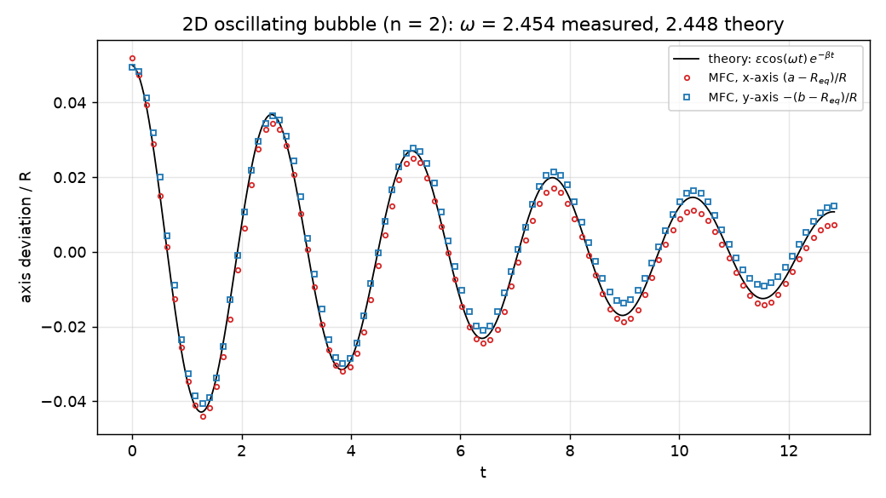

# Oscillating Bubble (2D, all-Mach pressure projection)

A validation of surface tension. A gas bubble of radius R in a liquid (density ratio 1000) starts at rest as an ellipse of
semi-axes R(1 ± 0.05), the n = 2 shape mode, and oscillates about its circle. For small amplitude ε the axes follow
R ± εR cos(ωt) e^(−βt), with Lamb's frequency of a 2D (cylindrical) interface,

ω² = n(n² − 1) σ / ((ρ_g + ρ_l) R³),

and the viscous decay of the irrotational mode in the liquid outside the bubble, β = 2n(n + 1) ν_l / R² (the dissipation of the
potential flow r⁻ⁿ cos nθ over twice its kinetic energy). One quadrant is simulated, 32 cells per radius, with symmetry planes
along both axes. The liquid is a stiffened gas with sound speed 100 and the bubble an ideal gas (sound speed ~370) against flow
speeds of ~0.1, so the projection steps at the capillary limit; `--explicit` runs the HLLC solver at the acoustic one. The
reference pressure, 100, keeps the bubble's breathing mode near ω ≈ 14, well above the shape mode, so the two do not exchange
energy.

```shell
./mfc.sh run examples/2D_oscillating_bubble_projection/case.py -n 4
```

`result.png` shows the validation result: the deviation of the bubble's x and y semi-axes from the equivalent radius over five
periods (symbols) against the linear theory (line).



The measured frequency, from the zero crossings of the axis difference, is 2.454 against Lamb's 2.448 (+0.23%), and the decay
rate fitted to the peaks is 0.125 against 0.120. The bubble's area changes by less than 1e-4 over the run.
