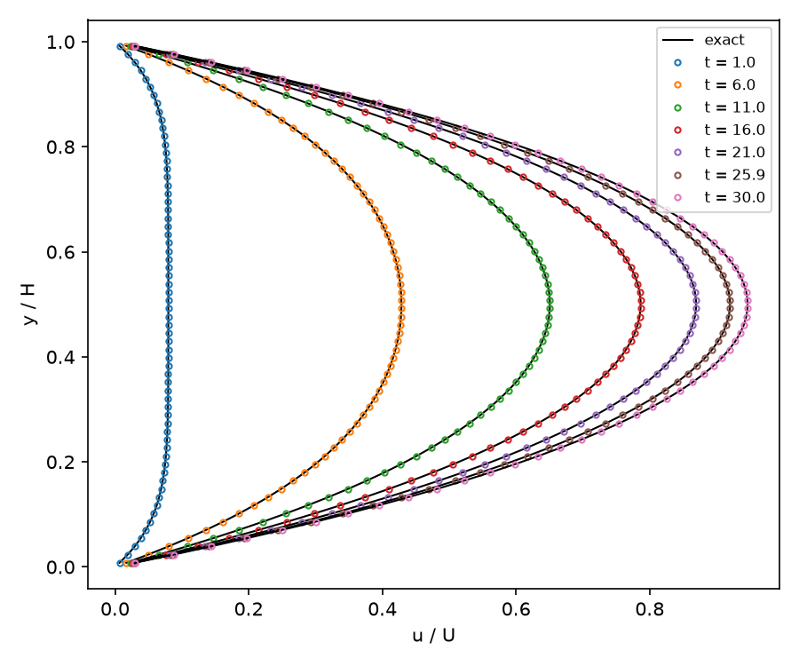

# Plane Poiseuille Flow Startup (2D, all-Mach pressure projection)

Fluid at rest between two fixed walls, periodic along the channel, is driven by a uniform body force (`bf_x`) that stands in
for the mean pressure gradient. The fluid is a stiffened gas at Mach 0.01, so the flow is nearly incompressible. `result.png` shows
the validation result: the velocity profile across the gap at several times (symbols) against the exact transient (lines).

