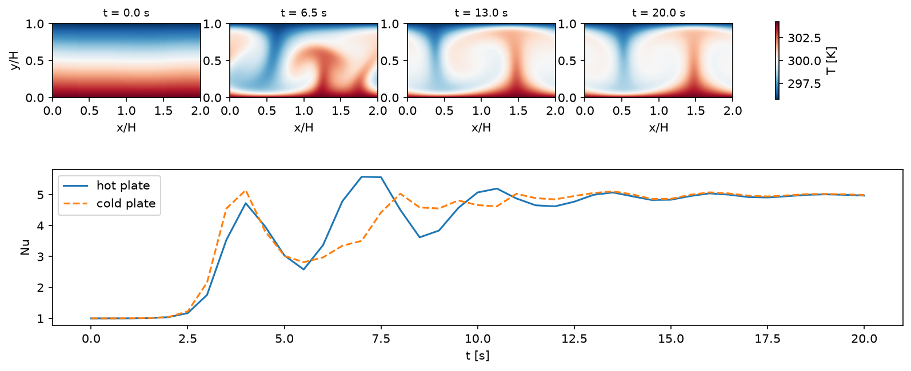

# Rayleigh-Bénard Convection (2D, all-Mach pressure projection)

Air between a hot lower plate and a cold upper plate, 5 cm apart and periodic over two plate gaps. The plates are no-slip
isothermal walls (`bc_y%isothermal_in/out`); heat crosses the gap by Fourier conduction (`fluid_pp(1)%k_therm`). The air
starts in the conduction profile with a 1% temperature perturbation. `Ra` and `Pr`, set at the top of `case.py`, give the plate
temperature difference and the conductivity (air's viscosity throughout).

At the defaults, Ra = 1e5 and Pr = 0.71 (dT = 8.5 K), the flow Mach number is ~3e-4. The projection steps at the pace of the
conduction and the flow, so the run (256 x 128 cells, 20 s) takes 16,600 steps. `result.png` shows the validation result: the
temperature field of the rolls and the plates' Nusselt numbers over time.

Verification: at Pr = 7 and Ra = 4e4 (with `ny = 64` and `tstop = 300` in `case.py`) the rolls reach a steady Nu = 3.68 at both plates,
on the steady primary branch of Waleffe, Boonkasame & Smith, Phys. Fluids 27, 051702 (2015), Fig. 1 (~3.7 at L/H = 2).

