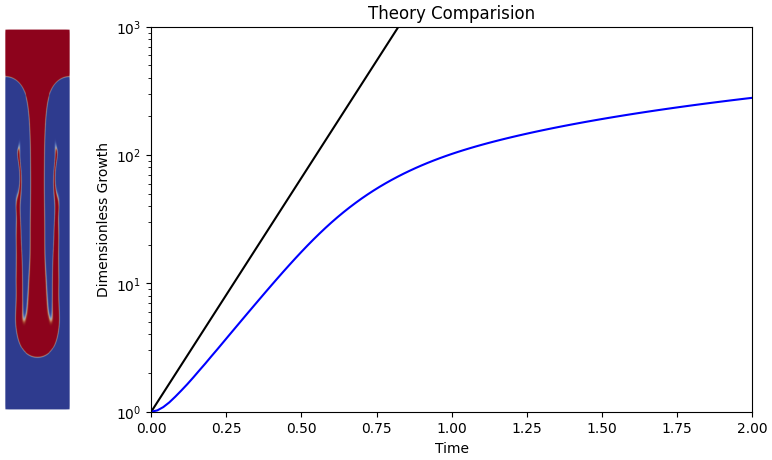

# Rayleigh-Taylor Instability (2D)

## Final Condition and Linear Theory

## Linear growth rate

`check_rt.py` measures the cos(k x) amplitude of the interface (the light-fluid column height) at each save, fits
a = A exp(n t) + B exp(-m t) over the saves with k a <= 0.25, and compares n with the growth rate of the linearized incompressible
Navier-Stokes equations for the same density and viscosity profiles (a quadratic eigenproblem solved in the script; 6.507 1/s,
against sqrt(A g k) = 12.41 1/s without viscosity).

    ./mfc.sh run examples/2D_rayleigh_taylor/case.py -t pre_process simulation post_process -n 1 --gpu --case-optimization -- -N 100 --tend 0.6 --saves 60
    python3 examples/2D_rayleigh_taylor/check_rt.py examples/2D_rayleigh_taylor --case-args "-N 100 --tend 0.6 --saves 60"

`case.py` takes `-N` (cells per wavelength, default 200), `--tend` (default 2 s) and `--saves` (default 100). Measured:

| N | platform | n [1/s] | error |
|---:|---|---:|---:|
| 32 | GNU 13.3 CPU, one rank | 6.4337 | -1.12 % |
| 32 | NVIDIA A100, NVHPC 25.11 | 6.4337 | -1.12 % |
| 64 | NVIDIA A100 | 6.4560 | -0.78 % |
| 100 | NVIDIA A100 | 6.4611 | -0.70 % |

The 32-cell CPU run takes 66 minutes; the 100-cell GPU run about 1.5 hours. On NVIDIA GPUs use `--case-optimization`
([#2466](https://github.com/MFlowCode/MFC/issues/2466)). See @ref validation_interface_instabilities.

`mpp_lim` is off: this case runs without it, and it breaks pressure equilibrium at material interfaces (see `mpp_lim` in @ref case).
