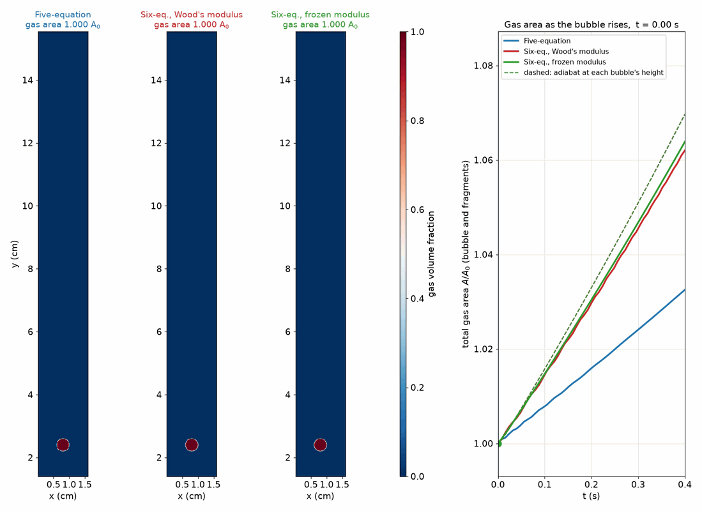

# Expanding Rising Bubble (2D, all-Mach pressure projection, six-equation model)

A 4 mm gas bubble rises from rest through a 30 cm liquid column whose top is a pressure outlet at 1 atm. The hydrostatic pressure
falls by 28% over the column, so the gas should expand along its adiabat as the bubble rises.
The liquid is a synthetic viscous oil under ten-fold gravity (rho = 965 kg/m^3, mu = 0.23 Pa s, sigma = 0.30 N/m,
g = 98.1 m/s^2; Eotvos 5, Morton 0.01). The viscosity keeps the rise steady (0.31 m/s, Reynolds ~5) with no wake shedding.

## Result, t = 0.4 s

The five-equation model (`--five`), the six-equation model with Wood's modulus (`--wood`) and the six-equation model with the
frozen modulus (the default), with each run's gas area against the adiabat at its bubble's height.

