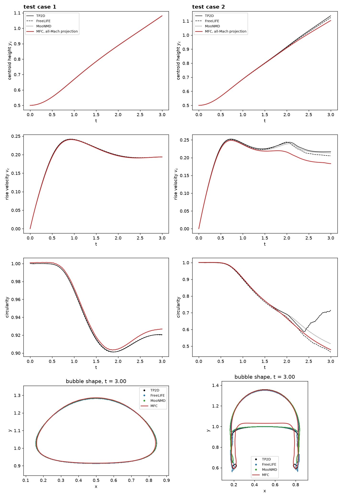

# Rising Bubble Benchmark (2D, all-Mach pressure projection)

The rising-bubble benchmark of Hysing et al. (International Journal for Numerical Methods in Fluids 60:1259-1288, 2009):
a bubble of diameter 0.5 rises under gravity in a 1 x 2 box with viscosity and surface tension.
Test case 1 (density ratio 10, viscosity ratio 10, Eo = 10) stays compact; test case 2 (density ratio
1000, viscosity ratio 100, Eo = 125) develops a skirt and thin trailing filaments. `--case` selects the test case;
the resolution `ppl` (h = 1/ppl, default 80) is set at the top of `case.py`.

```shell
./mfc.sh run examples/2D_rising_bubble_projection/case.py --case-optimization -- --case 1
./mfc.sh run examples/2D_rising_bubble_projection/case.py --case-optimization -- --case 2
```

Both phases are stiffened gases with a water-like sound speed (1500), so the flow Mach number is
~2e-4. The projection steps at the flow's pace; `--explicit` runs the HLLC solver, which must
resolve the sound speed. At h = 1/40, test case 1 takes 1,660 projection steps (2.5 min on one A100)
against ~720,000 explicit steps (~2.4 h), about 58x in wall time. At h = 1/80 the projection takes 4,593 steps for test
case 1 and 20,506 for test case 2, whose thin skirt sets a viscous limit.

## Validation against the reference, h = 1/80

`result.png` shows the validation result: the bubble's centroid height, rise velocity, circularity and final shape for test
case 1 (left) and test case 2 (right), against the benchmark's reference data from three groups (TP2D, FreeLIFE and MooNMD;
see the [FeatFlow benchmark page](http://www.featflow.de/en/benchmarks/cfdbenchmarking/bubble.html)).



| test case 1             | h = 1/40 | h = 1/80 | TP2D (finest) |
|-------------------------|----------|----------|---------------|
| min circularity         | 0.912    | 0.903    | 0.901         |
| max rise velocity       | 0.238    | 0.241    | 0.242         |
| centroid height, t = 3  | 1.081    | 1.081    | 1.081         |

Test case 2 converges toward the reference more slowly: from h = 1/40 to 1/80 the first rise-velocity
peak goes 0.244 -> 0.249 (TP2D 0.252) and the final centroid 1.090 -> 1.104 (TP2D 1.138), and the
final circularity (0.479) lies between FreeLIFE's and MooNMD's. The second rise-velocity peak near t = 2 is
not yet reproduced at these resolutions, and the late rise velocity stays ~15% low.
