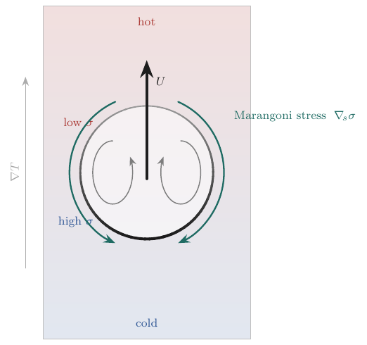

# Thermocapillary droplet migration — σ(T) validation against Samareh et al. (2014)

Validation of temperature-dependent surface tension (`sigma_model = 1`, linear σ(T)) against the
thermocapillary-migration benchmarks of

> B. Samareh, J. Mostaghimi, C. Moreau, "Thermocapillary migration of a deformable droplet,"
> *Int. J. Heat Mass Transfer* 73 (2014) 616–626.

A drop in an imposed linear temperature field sees a surface-tension gradient along its interface
(σ falls as T rises, dσ/dT < 0). The resulting tangential Marangoni stress drags interfacial fluid
hot→cold and, by reaction, the drop migrates toward the hot wall.



This example covers the two σ(T)-only Samareh cases (§4.1.1 and §4.1.2). The large-Marangoni case
(§4.2) also needs temperature-dependent viscosity and is not included.

| | Samareh scenario | Regime | Figure | Reference |
|---|---|---|---|---|
| TC1 (`case_Ma_0p001.py`) | Zero Marangoni number (§4.1.1) | Ma → 0 | Fig 5 (2D cylinder) | plateau v_t/v_YGB ≈ 0.80 |
| TC2 (`case_Ma_20.py`) | Low Marangoni, Nas & Tryggvason (§4.1.2) | Re = 5, Ma = 20, Ca = 0.0167 | Fig 7 | peak U* ≈ 0.13 |

## Setup

`sigma_model = 1` evaluates σ(T) = `sigma` + `sigma_dTdT`·(T − `sigma_T_ref`) per cell and averages
it to each face of the capillary flux, so the tangential variation of σ along the interface is the
Marangoni stress. T is the conduction temperature, so the model requires `fluid_pp(i)%k_therm > 0`.

MFC is compressible: at uniform pressure the EOS gives T = (p+p∞)/((γ−1)ρcv), so the linear T(y) is
imposed through the density initial condition, ρ(y) ∝ 1/T(y). The drop is painted inside a single
full-box analytic patch so T is continuous across the interface. Bulk conduction and isothermal
slip walls (`bc_y = -15`, `isothermal_in/out`) then hold the imposed gradient against the drop's own
advection.

## Results

Measured with `measure.py` at 64 cells across the box (Intel ifx, CPU, `--case-optimization`):

| | Cells per D | Measured | Reference | Wall time |
|---|---|---|---|---|
| TC1 | 12.8 | plateau v_t/v_YGB = 0.857 at t/t_r = 0.6, 0.876 at t/t_r = 2 | ≈ 0.80 | 3.7 h on 6 ranks |
| TC2 | 32 | peak U* = 0.134 at t* = 3.7 | ≈ 0.13 | 18.5 min on 8 ranks |

TC1 settles 7% above the reference and then creeps up slowly (+0.005 per t_r over the last t_r);
finer TC1 grids were not run for this table. In TC2 the drop rises toward the hot wall and U* decays
steadily after the peak, reaching 0.071 at t* = 15 when the run ends; the late-time value is not
converged.

## Caveats

- Compressible acoustics. The closed box rings (the unbalanced t = 0 Laplace jump excites the
  vertical acoustic standing wave). Read the migration velocity as the mean of the oscillation.
  Samareh's incompressible solver has no acoustics.
- Small Ma is expensive. TC1 approaches Samareh's Ma = 0 (frozen-T) limit through a large thermal
  diffusivity, so its time step is conduction-limited (dt ∝ Ma).
- Distinct-fluid finite Ma is qualitative. In TC2 each fluid's absolute density stratifies as ~1/T
  (a compressibility artifact absent in the incompressible reference), so the exact peak is
  fidelity-limited; TC1's identical fluids avoid this.

## Reproducing

```bash
# One case in place. Output lands beside the case files and measure.py reads every snapshot in
# restart_data/, so delete restart_data/ before running the other case here.
# --case-optimization is roughly 10x faster.
./mfc.sh run examples/2D_thermocapillary_migration/case_Ma_20.py -n 8 --case-optimization
python3 examples/2D_thermocapillary_migration/measure.py examples/2D_thermocapillary_migration fig7

# Grid sweeps into runs/<case>/<grid>/, summarized in runs/*.json
python3 examples/2D_thermocapillary_migration/run.py fig5   # TC1, 64/128/256 cells across
python3 examples/2D_thermocapillary_migration/run.py fig7   # TC2, 64/128 cells across
```
