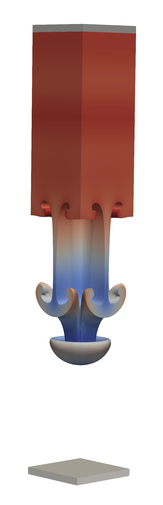
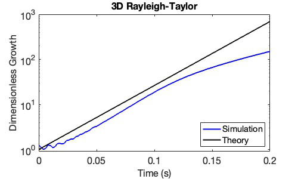

# Rayleigh-Taylor Instability (3D)

## Final Condition and Linear Theory

`mpp_lim` is off: this case runs without it, and it breaks pressure equilibrium at material interfaces (see `mpp_lim` in @ref case).
